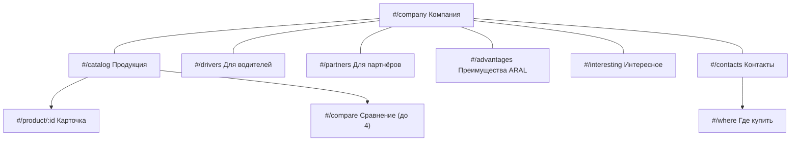

# ARAL — карта сайта

## Главное меню (порядок утверждён)

Компания → Продукция → Для водителей → Для партнёров → Преимущества ARAL → Интересное → Контакты.
Главной страницей служит «Компания»; логотип ARAL в черновиках остаётся таким, как в исходниках.

## Маршруты

| Адрес сайта | Файл и внутренний адрес | Содержимое |
|---|---|---|
| `#/company` (по умолчанию) | `pages/v8.html#company` | история, хронология 8 дат, специалисты, качество |
| `#/catalog` | `pages/products.html#/catalog` | 17 продуктов / 47 SKU, поиск, фильтры, сортировка |
| `#/product/ARAL-001` … `ARAL-017` | `pages/products.html#/product/…` | фасовки, покупка, описание, примечание, спецификации, PDS/SDS |
| `#/compare` | `pages/products.html#/compare` | сравнение до четырёх продуктов, печать |
| `#/drivers` | `pages/drivers.html` | 7 разделов для водителей |
| `#/partners` | `pages/partners.html` | аудитория, 6 преимуществ, порядок работы, карта, контакты |
| `#/advantages` | `pages/advantages.html` | XMF®, отложения, защита деталей, старение масла |
| `#/interesting` | `pages/v8.html#interesting` | 6 статей |
| `#/contacts` | `pages/contacts.html` | опт, склад, справочник 35 магазинов, OSTVIN, сайты |
| `#/where` | `pages/contacts.html#contacts-stores` | справочник магазинов |

Якоря внутри страниц (`#drv-steps`, `#part-audience`, `#adv-xmf` и т. д.) работают как в черновиках.

## Внешние переходы (из черновиков)

| Назначение | Адрес |
|---|---|
| Опт — Склад СПК | https://skladspk.ru/contacts, https://skladspk.ru/ |
| Розница — Центр АвтоМасел | https://centravtomasel.ru/, /contacts |
| Сервис — OSTVIN | https://ostvin.ru/zamena_masla |
| Документы ARAL | https://msdspds.aral.com/ |
| Фото упаковок каталога | raw.githubusercontent.com/AlexALP9/ARAL- (как в revision 15) |
